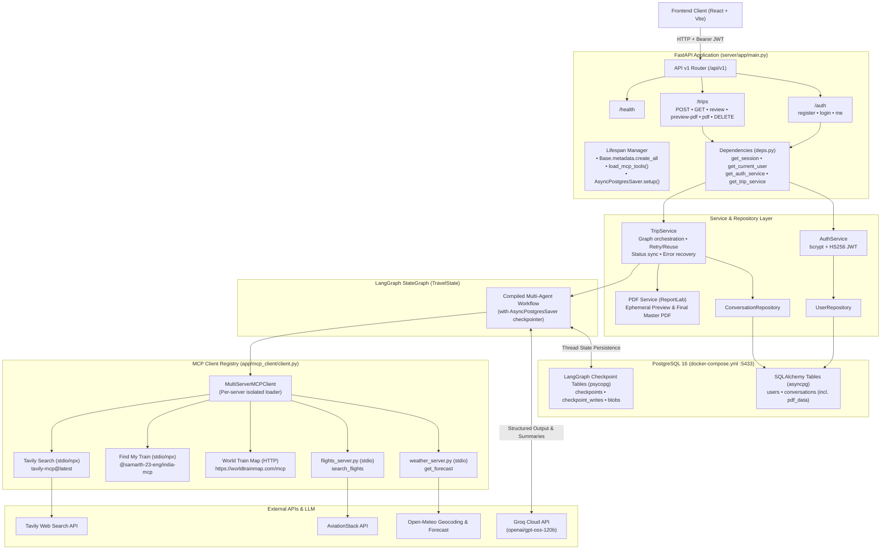
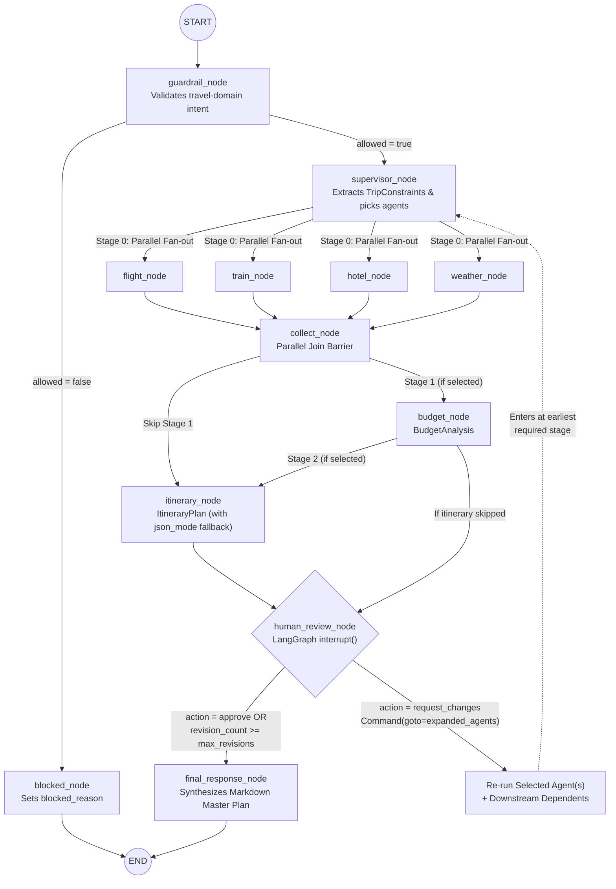
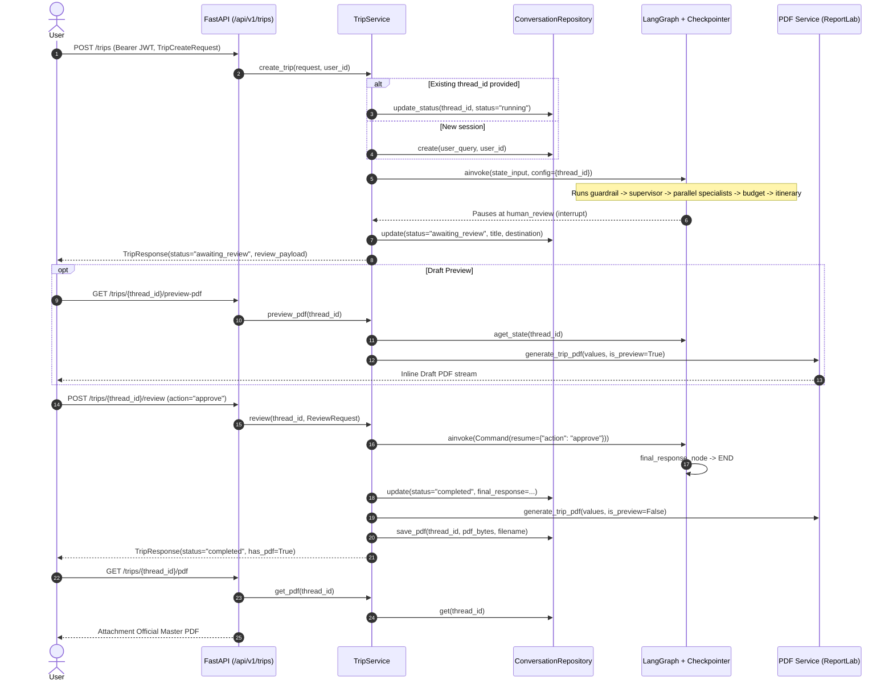

# Server Architecture Documentation

This document provides a complete architectural reference for the **AI-Travel_planner** backend (`server/`), built with **FastAPI**, **LangGraph**, **Groq LLM (`ChatGroq`)**, **Model Context Protocol (MCP)**, **PostgreSQL** (dual async drivers: `asyncpg` + `psycopg`), and **ReportLab**.

---

## 1. High-Level System Architecture



---

## 2. Technology Stack

| Layer | Technology / Library | Purpose |
| :--- | :--- | :--- |
| **Web Framework** | `fastapi`, `uvicorn[standard]` | Async REST API & ASGI server |
| **Agent Orchestration** | `langgraph`, `langchain-core` | Stateful DAG, parallel fan-out, `interrupt()` HITL |
| **LLM Provider** | `langchain-groq` (`openai/gpt-oss-120b`) | Structured outputs (`function_calling` & `json_mode`) and synthesis |
| **Tool Protocol** | `mcp`, `langchain-mcp-adapters` | Local `stdio` & remote `http` MCP tool servers |
| **ORM & Migrations** | `sqlalchemy[asyncio]`, `asyncpg`, `alembic` | Async ORM models (`users`, `conversations`) & schema migrations |
| **Checkpointer** | `langgraph-checkpoint-postgres`, `psycopg[binary,pool]` | Persistent LangGraph state per `thread_id` |
| **Authentication** | `pyjwt` (HS256), `bcrypt` | Password hashing & stateless JWT bearer auth |
| **PDF Generation** | `reportlab` | Branded multi-page travel master PDFs |
| **Config & Validation** | `pydantic`, `pydantic-settings` | `.env` configuration & request/response schemas |
| **Tooling & Tests** | `uv`, `ruff`, `pytest`, `pytest-asyncio` | Dependency management, linting, unit tests |

---

## 3. Directory Structure

```text
server/
├── alembic.ini                     # Alembic migration configuration
├── docker-compose.yml              # PostgreSQL 16 service (port 5433 -> 5432)
├── pyproject.toml                  # Dependencies, Ruff rules, Pytest config
├── mcp_servers/
│   ├── weather_server.py           # FastMCP stdio server (Open-Meteo 16-day forecast)
│   └── flights_server.py           # FastMCP stdio server (AviationStack schedule lookup)
├── migrations/
│   └── versions/                   # Alembic schema revisions (conversations, users, pdf)
├── tests/
│   └── test_pdf.py                 # Unit tests for PDF generation
└── app/
    ├── main.py                     # FastAPI factory & lifespan startup/shutdown
    ├── core/
    │   ├── config.py               # Pydantic Settings (.env)
    │   ├── exceptions.py           # Domain exceptions (TripNotFound, etc.)
    │   ├── logging.py              # Logging configuration
    │   └── security.py             # bcrypt hashing & JWT encode/decode
    ├── db/
    │   ├── base.py                 # SQLAlchemy DeclarativeBase
    │   └── session.py              # AsyncEngine & SessionLocal (asyncpg)
    ├── models/
    │   ├── user.py                 # User ORM model
    │   └── conversation.py         # Conversation + PDF binary ORM model
    ├── repositories/
    │   ├── user_repository.py      # User CRUD queries
    │   └── conversation_repository.py # Conversation CRUD, status updates, PDF storage
    ├── schemas/
    │   ├── user.py                 # UserCreate, UserLogin, TokenResponse, UserResponse
    │   └── trip.py                 # TripCreateRequest, ReviewRequest, TripResponse, TripHistoryItem
    ├── services/
    │   ├── auth_service.py         # Registration & login logic
    │   ├── trip_service.py         # Graph execution, session reuse, failure recovery, PDF save
    │   └── pdf_service.py          # ReportLab PDF builder (preview & final)
    ├── api/
    │   ├── deps.py                 # FastAPI DI providers & JWT guard
    │   └── v1/
    │       ├── router.py           # Combines health, auth, trips routers
    │       └── endpoints/
    │           ├── health.py       # GET /api/v1/health
    │           ├── auth.py         # POST /register, POST /login, GET /me
    │           └── trips.py        # Trip CRUD, HITL review, PDF preview & download
    ├── mcp_client/
    │   └── client.py               # MCP server loader, tool registry, railway fallback
    └── agents/
        ├── llm.py                  # Cached ChatGroq factory (max_tokens=8192, timeout=60)
        ├── prompts.py              # System prompts for all agents
        ├── routing.py              # Staged execution & dependency expansion
        ├── state.py                # TravelState TypedDict & TripConstraints schema
        ├── graph.py                # LangGraph StateGraph wiring
        └── nodes/
            ├── guardrail.py        # Travel-domain validator & blocked handler
            ├── supervisor.py       # Extracts constraints & selects specialist agents
            ├── flight.py           # IATA lookup + AviationStack MCP + summary
            ├── train.py            # Live railway MCP / corridor intelligence + summary
            ├── hotel.py            # Tavily search + structured HotelResults extraction
            ├── weather.py          # Open-Meteo MCP + packing/climate summary
            ├── budget.py           # Structured BudgetAnalysis (nullable transit estimates)
            ├── itinerary.py        # Structured ItineraryPlan (with json_mode fallback)
            ├── human_review.py     # LangGraph interrupt() + revision router
            └── final_response.py   # Synthesizes final Markdown travel master plan
```

---

## 4. LangGraph Multi-Agent Workflow

The core intelligence is orchestrated as a staged, cyclic **LangGraph `StateGraph`** compiled with `AsyncPostgresSaver`.

### 4.1 Graph Topology



### 4.2 Shared `TravelState` & Reducers (`app/agents/state.py`)
Because Stage 0 agents (`flight`, `train`, `hotel`, `weather`) execute **concurrently**, `TravelState` uses safe reducer annotations:
- `messages: Annotated[list[AnyMessage], add_messages]`
- `llm_calls: Annotated[int, operator.add]`
- Specialist outputs write to disjoint keys: `flight_results`, `train_results`, `hotel_results`, `weather_info`, `budget_analysis`, `itinerary_plan`.

### 4.3 Staged Routing & Dependency Expansion (`app/agents/routing.py`)
Agents are organized into ordered stages:
```python
STAGES = [["flight", "train", "hotel", "weather"], ["budget"], ["itinerary"]]
```
When a user requests changes during `human_review`, an LLM selects the minimal `agents_to_rerun`, and `expand_with_dependents()` automatically pulls in downstream dependents:
- `flight` / `train` / `hotel` $\rightarrow$ `["budget", "itinerary"]`
- `weather` / `budget` $\rightarrow$ `["itinerary"]`

---

## 5. End-to-End Request & HITL Lifecycle



---

## 6. MCP Server Integration (`app/mcp_client/client.py`)

`load_mcp_tools()` connects to each MCP server **independently** inside isolated `try/except` blocks so one slow or unreachable external server never prevents local tools from loading:

| Server Name | Transport | Source / Command | Exposed / Used Capabilities |
| :--- | :--- | :--- | :--- |
| `weather` | `stdio` | `mcp_servers/weather_server.py` | `get_forecast(city, days)` via Open-Meteo (up to 16 days) |
| `flights` | `stdio` | `mcp_servers/flights_server.py` | `search_flights(dep_iata, arr_iata)` via AviationStack |
| `world_train_map` | `http` | `https://worldtrainmap.com/mcp` | `city_pair`, `search_routes`, `night_trains`, `routes_in_country` |
| `find_my_train` | `stdio` | `npx -y @samarth-23-eng/india-mcp railways` | Live Indian Railways status & trains between stations (with `CITY_TO_STATION_CODE` resolver) |
| `tavily` | `stdio` | `npx -y tavily-mcp@latest` | Live web search for hotel discovery (`hotel_node`) |

If remote train MCP servers are unreachable or lack a specific regional corridor, `search_train_routes` gracefully falls back to `_get_sector_routes()` (covering Indian Railways, Japanese Shinkansen, and general intercity corridors).

---

## 7. API Endpoints Summary (`/api/v1`)

| Method | Endpoint | Auth | Description |
| :--- | :--- | :--- | :--- |
| `GET` | `/health` | No | Health check (`{"status": "ok"}`) |
| `POST` | `/auth/register` | No | Register user & return HS256 JWT |
| `POST` | `/auth/login` | No | Authenticate user & return HS256 JWT |
| `GET` | `/auth/me` | Yes | Return authenticated `UserResponse` |
| `POST` | `/trips` | Yes | Start new trip or retry existing `thread_id`; catches graph failures into `status="failed"` |
| `GET` | `/trips` | Yes | List user's past journeys (`TripHistoryItem[]`) |
| `GET` | `/trips/{thread_id}` | No* | Fetch synced trip state from PostgreSQL + LangGraph checkpoint |
| `POST` | `/trips/{thread_id}/review` | No* | Resume HITL `interrupt()` (`approve` or `request_changes`) |
| `GET` | `/trips/{thread_id}/preview-pdf` | No* | Stream ephemeral draft PDF during review |
| `GET` | `/trips/{thread_id}/pdf` | No* | Download finalized PDF stored in PostgreSQL `pdf_data` |
| `DELETE` | `/trips/{thread_id}` | Yes | Delete journey owned by `current_user` |

*\*Note: `GET /trips/{thread_id}`, `POST /trips/{thread_id}/review`, and PDF endpoints validate existence via `ConversationRepository` and can be scoped further with `get_current_user` if strict per-route ownership enforcement is desired.*

---

## 8. Database Architecture

Two PostgreSQL connection layers share the same Postgres instance (`localhost:5433/travel_db` in `docker-compose.yml`):

1. **SQLAlchemy Async (`asyncpg`)** — `app/db/session.py`:
   - `users`: `id (UUID PK)`, `email (unique)`, `hashed_password`, `name`, `created_at`, `updated_at`
   - `conversations`: `id (UUID PK / thread_id)`, `user_id (FK -> users.id CASCADE)`, `title`, `destination`, `user_query`, `status`, `final_response`, `blocked_reason`, `pdf_data (LargeBinary)`, `pdf_filename`, `pdf_created_at`, `created_at`, `updated_at`
   - Ensured at startup via `Base.metadata.create_all` in `main.py` and versioned via Alembic in `server/migrations/`.

2. **LangGraph Checkpointer (`psycopg` AsyncConnectionPool)** — `app/main.py`:
   - `checkpointer.setup()` initializes LangGraph's checkpoint tables (`checkpoints`, `checkpoint_writes`, `checkpoint_blobs`, `checkpoint_migrations`) to persist graph state across `interrupt()` pauses and human-in-the-loop revisions.

